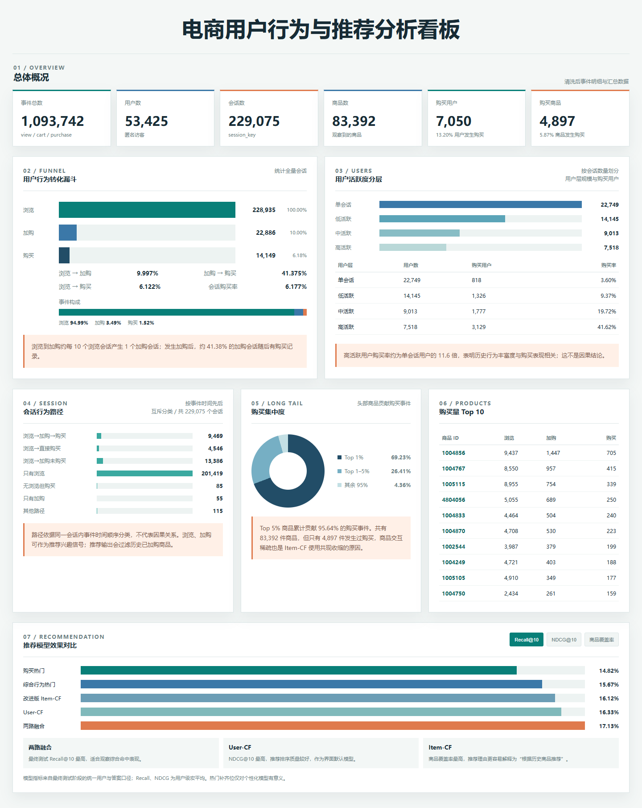
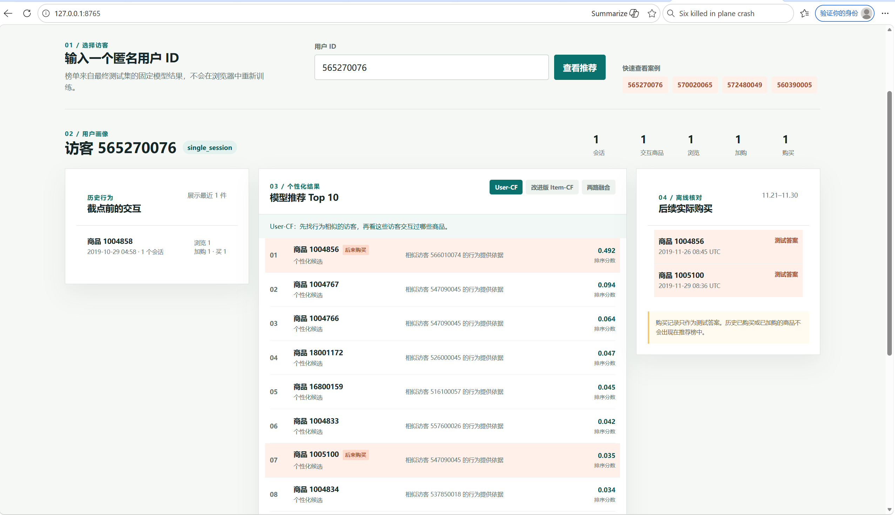

# 电商个性化推荐系统

基于 Retailrocket 匿名电商行为数据，完成从数据清洗、SQL 业务分析、协同过滤建模、时间切分离线评估，到中文推荐演示界面的端到端项目。

项目关注的问题是：**用户浏览、加购等历史行为，能否帮助推荐其之后可能购买的商品？与热门推荐相比，个性化推荐是否命中更多，同时又会带来怎样的商品覆盖和热门集中度？**

> 本项目使用匿名用户 ID 和商品 ID。模型分数只是排序分数，不是购买概率；离线测试结果不能证明线上转化率、销售额或利润提升。

## 项目流程

```text
用户级抽样与数据清洗
        -> SQL 漏斗、用户分层和商品分析
        -> 按时间构造训练 / 验证 / 测试数据
        -> 热门基线、Item-CF、User-CF
        -> 验证集选择参数与融合策略
        -> 最终测试集一次性评估
        -> 输入用户 ID 查看历史、推荐和后续购买
```

## 分析看板预览

看板汇总展示总体数据概况、用户行为漏斗、用户活跃度分层、会话路径、商品购买集中度和最终测试模型对比。完整看板见 [`dashboard.html`](dashboard.html)，图片预览如下：

<p align="center">
  
</p>

## 推荐工作台预览

推荐工作台支持输入匿名用户 ID，查看推荐截点前的历史行为，并切换 User-CF、改进版 Item-CF 和两路融合三种推荐结果；后续实际购买会单独标记用于离线核对。

<p align="center">
  
</p>

## 数据与时间边界

项目使用 Retailrocket 电商行为数据。事件类型包括浏览（view）、加购（cart）和购买（purchase）。原始用户和商品标识匿名，不将匿名属性解释成真实商品名称、品牌或价格。

本地数据处理采用 Polars 和 Parquet，SQL 业务分析使用 SQL Server（通过 DBeaver 连接）。

模型时间边界均按 UTC 解释：

| 阶段 | 可用于模型的历史 | 后续购买答案 |
|---|---|---|
| 验证 | 2019-10-01 至 2019-11-10 | 2019-11-11 至 2019-11-20 |
| 最终测试 | 2019-10-01 至 2019-11-20 | 2019-11-21 至 2019-11-30 |

推荐规则为 `exclude_cart_and_purchase`：推荐时排除用户历史已购买或已加购的商品，但仍使用这些历史行为学习偏好；只浏览过的商品可以推荐。评估时相同的历史已购和已加购答案也会排除。测试期购买只用于最后核对，不进入训练或参数选择。

最终测试共有 1,355 位购买用户和 1,976 组去重用户－商品购买答案。排除历史已购 160 组、历史仅加购 61 组后，最终评价 1,229 位用户和 1,755 组答案；126 位用户没有剩余可评估答案。训练商品库中未出现的购买答案仍保留在总体 Recall 分母中。

## 模型方案

- **热门基线**：购买热门和综合行为热门，用于比较个性化方法是否优于简单策略。
- **改进版 Item-CF**：根据同一用户交互过的商品建立相似关系；验证阶段选定最低共同用户数 2、共现收缩 15、开启 IUF、热门降权系数 0。
- **User-CF**：根据行为相似用户的历史交互为目标用户推荐商品。
- **两路融合（RRF）**：Item-CF 和 User-CF 各取最多 50 个候选，按名次融合，常数为 60；个性化候选不足时再用购买热门补齐。

验证阶段选定了 User-CF 作为界面默认模型。ALS 曾作为额外候选召回实验运行，但没有纳入最终方案；当前项目也没有使用 LightGBM 排序。

## 最终测试结果

`Recall@10` 和 `NDCG@10` 是对用户级结果取平均的离线排序指标。商品覆盖率是推荐过的去重商品数占训练商品库的比例。热门补齐位表示 Top 10 中由热门榜填补的位置比例。

| 模型 | Recall@10 | NDCG@10 | 有历史用户 Recall@10 | 商品覆盖率 | 热门补齐位 |
|---|---:|---:|---:|---:|---:|
| 购买热门 | 14.82% | 0.0887 | 12.93% | 0.023% | 0.00% |
| 综合行为热门 | 15.67% | 0.0912 | 13.63% | 0.024% | 0.00% |
| 改进版 Item-CF | 16.12% | 0.0931 | 14.78% | 3.884% | 30.47% |
| User-CF | 16.33% | **0.1024** | 15.08% | 3.001% | 34.21% |
| 两路融合（RRF） | **17.13%** | 0.1022 | **16.21%** | 3.247% | **29.72%** |

三种个性化方案在这次最终测试的 Recall 均高于综合行为热门。融合 Recall 最高；User-CF 的 NDCG 略高；Item-CF 的商品覆盖率更高。它们各有取舍，不将单个指标描述为所有方面都“最好”。

## 环境与依赖

建议使用项目内虚拟环境。核心离线分析和推荐模型依赖如下：

```powershell
Set-Location D:\user_behavior
python -m venv .venv
.\.venv\Scripts\python.exe -m pip install -r requirements.txt
```

`requirements.txt` 包含 Polars、NumPy 和 SciPy。只有复现 ALS 探索实验时才需要安装可选依赖：

```powershell
.\.venv\Scripts\python.exe -m pip install -r requirements-als.txt
```

## 运行 SQL 业务分析

SQL 脚本位于 [`sql_analysis/`](sql_analysis/)。完整说明、CSV 导入流程、表字段和执行顺序见 [`sql_analysis/README.md`](sql_analysis/README.md)。核心顺序是：

1. 清洗后的 Parquet 由 Polars 导出 CSV；
2. 在 SQL Server 建表并用 DBeaver 导入 CSV；
3. 创建分析索引；
4. 运行转化漏斗、用户分层、会话路径、商品长尾和时间切分 SQL。

原始文件较大，CSV/Parquet 和数据目录不应提交到公开代码仓库。

## 运行测试

```powershell
Set-Location D:\user_behavior
.\.venv\Scripts\python.exe -B -m unittest discover -s tests -p 'test_*.py' -v
```

测试覆盖稀疏 CF 与共现收缩、RRF 去重及分数、ALS 的可选功能、数据时间边界、历史已购/加购过滤和验证/最终测试流水线。当前实现的测试集包含 31 项测试。

## 打开中文推荐工作台

启动本地静态服务器：

```powershell
Set-Location D:\user_behavior
.\.venv\Scripts\python.exe -B ui\server.py --port 8765
```

然后在浏览器打开：

```text
http://127.0.0.1:8765
```

保持终端窗口运行即可访问；按 `Ctrl+C` 停止服务。工作台支持输入或搜索最终测试用户 ID、查看截点前的历史行为、切换三种 Top 10 推荐、查看推荐依据，并将后续购买单独标记用于离线核对。界面数据由最终测试结果静态生成，不会在浏览器里训练模型。

如果最终测试报告更新，重新生成界面数据：

```powershell
.\.venv\Scripts\python.exe -B scripts\build_recommender_ui_data.py
```

界面更多说明见 [`ui/README.md`](ui/README.md)。

## 目录结构

```text
models/                  热门、Item-CF、User-CF、ALS 和融合实现
scripts/                 抽样、清洗、模型数据准备、训练评估与界面数据生成脚本
tests/                   单元与流水线测试
sql_analysis/            SQL Server 业务分析脚本及说明
model_data/              时间切分后的模型输入和购买答案（本地数据）
reports/                 验证、最终测试和案例结果
ui/                      中文推荐工作台与静态数据
processed/               清洗后的本地数据（不适合提交到代码仓库）
sampled/                 用户级样本数据（不适合提交到代码仓库）
```

项目范围和分析规则见 [`PROJECT_FRAMEWORK.md`](PROJECT_FRAMEWORK.md)，模型数据和时间口径见 [`MODEL_DATA.md`](MODEL_DATA.md)，Item-CF 参数、公式和验证结果见 [`ITEM_CF_IMPROVEMENTS.md`](ITEM_CF_IMPROVEMENTS.md)，最终测试详情见 [`reports/cf_final_test/RESULTS.md`](reports/cf_final_test/RESULTS.md)。
